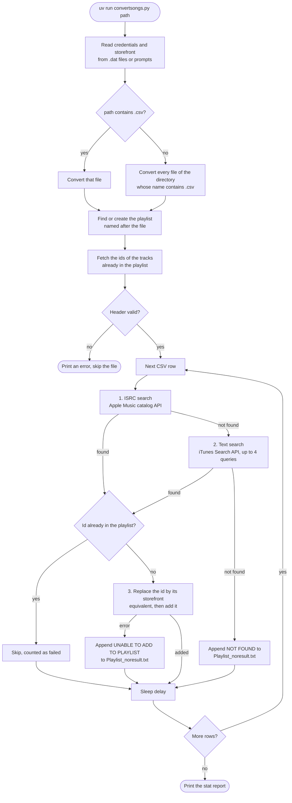

# How `convertsongs.py` works

This document describes the algorithm `convertsongs.py` uses to turn a CSV playlist into an Apple Music playlist: how it finds each track in the Apple Music catalog, adds it to the playlist and reports the results. It is meant for changing the script. The CSV it reads is described in [CSV input format](../README.md#csv-input-format), and how to run it in [Usage](../README.md#usage).

Functions are named rather than given line numbers, since line numbers change with every edit.

## Overview



Each track goes through two matching strategies in order, ISRC first, text second, and the first track id found wins. Neither strategy scores its candidates: each walks through the candidates in the order Apple returns them and accepts the first one that passes a rule.

## 1. Start-up

The following runs **at import time**, before `__main__`, which matters if you want to import the module (see [Tests](#9-tests)):

1. If no argument is given, print the usage and exit.
2. Read four values with `get_connection_data(file, prompt)`, which returns the content of `file` if it exists, or else prompts for it on stdin:

   | File | Value | Used as |
   | --- | --- | --- |
   | `token.dat` | Apple Music bearer token | `Authorization` header |
   | `media_user_token.dat` | Media user token | `media-user-token` header |
   | `cookies.dat` | Browser session cookies | `Cookie` header |
   | `country_code.dat` | Storefront, e.g. `fr` | `{country_code}` in every catalog and search URL |

`__main__` then calls `create_playlist_and_add_song(file)` once per CSV file. When the argument is a directory, its files are converted in `os.listdir` order, which is arbitrary.

## 2. Per playlist: `create_playlist_and_add_song`

1. **Session**: a `requests.Session` gets the headers of the Apple Music web player (the tokens and cookies above, plus `Origin`/`Referer` `https://music.apple.com` and a browser `User-Agent`). Every `amp-api.music.apple.com` call goes through it; the iTunes Search API calls don't.
2. **Playlist name**: the file name, cut at its first `.`, with `_` replaced by spaces, then `str.capitalize()`d, which also lowercases every letter but the first: `My_Road_Trip.csv` gives `My road trip`.
3. **`create_apple_music_playlist`**: lists the user's library playlists (`GET /v1/me/library/playlists`) and reuses the first one with exactly that name. Otherwise it creates one (`POST`). A 400, 401 or 403 answer prints an explanation and exits.
4. **`get_playlist_track_ids`**: fetches the catalog ids of the tracks already in the playlist (`GET /v1/me/library/playlists/{id}/tracks`), to skip duplicates. A 404 (an empty new playlist) gives an empty list.
5. **Header check**: columns 1, 3 and 5 must be one of the localized names of `csv_column_names.py`, and column 16 must be `ISRC`. Otherwise the file is skipped (see [Header check](../README.md#header-check)).
6. **Rows**: for each row, read `title` (column 1), `artist` (3), `album` (5), `album_artist` (7), `date` (8) and `isrc` (16), passing each through `escape_apostrophes`, which turns `'` into `\'`. The other columns are ignored.

## 3. Matching a track

### 3.1 ISRC search: `match_isrc_to_itunes_id(session, album, album_artist, isrc)`

An ISRC identifies a recording, but the same recording appears on several releases (single, album, compilation, remaster), each with its own Apple Music id. So this step searches by ISRC, then picks the release that matches the CSV's album.

**Request**: `GET https://amp-api.music.apple.com/v1/catalog/{country_code}/songs?filter[isrc]={isrc}`, through the authenticated session.

It returns `None`, which leads to the text search, when the request fails, the answer isn't a 200, or `data` is empty.

**Matching**: for each candidate song in the order returned, take its `albumName` and `artistName`, lowercase them and escape their apostrophes, then compare them with `album` and `album_artist` (lowercased, already escaped). The first candidate to pass **one** of these rules wins:

| # | Album name | Artist name |
| --- | --- | --- |
| 1 | equal | equal |
| 2 | equal | one contains the other |
| 3 | starts with the first 7 characters of the CSV album | starts with the first 7 characters of the CSV album artist |
| 4 | equal | anything |

The rules are checked for each candidate in turn, not each rule across all candidates. A candidate passing rule 4 therefore wins over a later candidate passing rule 1.

Every rule needs the album to match, so a recording found by ISRC on a different release (e.g. a compilation track when Apple only has the original album) is rejected and goes to the text search.

### 3.2 Text search: `get_itunes_id(title, artist, album, date)`

**Requests**: the public [iTunes Search API](https://developer.apple.com/library/archive/documentation/AudioVideo/Conceptual/iTuneSearchAPI/Searching.html), without authentication:

```text
https://itunes.apple.com/search?country={country_code}&media=music&entity=song&limit=15&term={title}
```

Up to four queries are sent, stopping at the first one where `try_to_match` accepts a result:

1. `term` + `artistTerm={artist}` + `albumTerm={album}`
2. `term` + `artistTerm={artist}`
3. `term` + `albumTerm={album}`
4. `term` only

`artistTerm` and `albumTerm` are not parameters of the Search API. They are values of its `attribute` parameter, so the API probably ignores them, and the four queries probably all search for the title alone. Check this before relying on the cascade.

`call_api(url)` sends each query. It tries up to 3 times, with no wait between tries. A 404, or 3 failures, gives `{"results": []}`.

**Matching: `try_to_match(url, title, artist, album, date)`** compares each result's `trackName`, `artistName` and `collectionName`, lowercased, with the CSV values, lowercased. The first result to pass **one** of these rules wins, and its `trackId` is returned:

| # | Rule |
| --- | --- |
| 1 | Title, artist and album are equal |
| 2 | `verify_release_date(result, date)` is true (see below) |
| 3 | Title and artist are equal |
| 4 | Title is equal, and one artist name contains the other once spaces are removed |
| 5 | **Artist name equals the CSV title**, and the CSV artist contains the track name, or the other way round, once spaces are removed |
| — | Title and album equal: commented out in the code, as it gave wrong matches |

As in the ISRC search, the rules are checked for each result in turn: the first result passing any rule wins, even if a later result would pass rule 1.

Rule 5 looks like it was meant to be "artist equal, title contained", but it compares the result's artist with the CSV *title* and the result's title with the CSV *artist*. So it only matches when the two fields are swapped.

**`verify_release_date(result, date)`** fetches the result's web page (`trackViewUrl`, with plain `requests.get`, not rate limited) and parses it with BeautifulSoup. It reads the first line of the `<p data-testid="tracklist-footer-description">` element, then compares it with the CSV's release date, both parsed by `dateparser`. Since rule 2 comes before rules 3 to 5, **every result that fails rule 1 costs one web page download**, even when `date` is empty and the comparison can't succeed (the page is fetched before the date is parsed). The Deezer CSV has no release date (see [CSV output](../README.md#csv-output)), so for those files rule 2 never matches but still downloads up to 15 pages per query.

## 4. Adding a track: `add_song_to_playlist`

1. If the id is already in the playlist's track ids, skip it. This counts as failed.
2. **`fetch_equivalent_song_id`**: `GET /v1/catalog/{country_code}/songs?filter[equivalents]={id}` returns the storefront's equivalent of the song, for ids that are not available in this storefront. If this request fails, the original id is kept. If the equivalent is already in the playlist, the track is skipped as a duplicate.
3. `POST /v1/me/library/playlists/{playlist_id}/tracks` with `{"data": [{"id": id, "type": "songs"}]}`. A 200, 201 or 204 is a success; anything else, or an exception, is an error.

The playlist's track ids are fetched once, before the first row, and are not updated as tracks are added. A track that appears twice in the CSV is therefore added twice.

## 5. Outputs

- **Console**: one line per track (`N°{n} | title | artist | album => {id}` or `=> NOT FOUND`), plus the API calls and errors.
- **`{playlist name}_noresult.txt`**, in the current directory: appended with `title | artist | album => NOT FOUND` for tracks no strategy matched, and `=> UNABLE TO ADD TO PLAYLIST` for tracks whose addition failed. It is never truncated, so it accumulates across runs.
- **Stat report**, at the end of each file:

  | Counter | Counts |
  | --- | --- |
  | Playlist Songs | CSV rows |
  | Converted Songs | Tracks added |
  | Failed Songs | Not found, failed to add, **or already in the playlist** |
  | Converted using ISRC / text based search | Tracks *matched* by each strategy, whether or not they were then added |

## 6. Pacing and rate limits

- `delay` (1 second, at the top of the file) is slept after every row. Before each addition, the script also sleeps `max(delay, 0.5)` seconds. A track that is added therefore takes at least 2 seconds. A duplicate takes no time, as it skips both sleeps.
- `call_api` (the iTunes Search API only) is decorated with `@limits(calls=19, period=1)`: 19 calls **per second**, while its comment says Apple allows 20 per minute. Without `@sleep_and_retry`, going past the limit raises `RateLimitException` instead of waiting. `try_to_match` catches it like any exception and **exits the program**.
- The catalog API calls (ISRC, equivalents, playlists) and the `verify_release_date` page downloads are not rate limited.

## 7. Known issues

Some of these are worth fixing before building on the affected code.

| Where | Issue | Effect |
| --- | --- | --- |
| Row parsing | `escape_apostrophes` is applied to the CSV values, then they are used in URLs and compared with iTunes values, which are not escaped | Text search: a title, artist or album with an apostrophe never matches exactly, and the search terms contain a backslash |
| `try_to_match`, rule 5 | Title and artist are swapped | The rule matches the wrong pairs (see 3.2) |
| `try_to_match`, rule 2 | Page download before the date check, for every result | Slow; useless when the date is empty, as with Deezer CSVs |
| `get_itunes_id` | `artistTerm` / `albumTerm` are not Search API parameters | The 4 queries are probably identical |
| `match_isrc_to_itunes_id`, rule 3 | With an empty album and album artist, `startswith("")` is always true | The first ISRC result is accepted without checking the album (see the [missing data report](../README.md#missing-data-report)) |
| `match_isrc_to_itunes_id` | Every rule needs the album to match | A recording found by ISRC on another release is rejected |
| `match_isrc_to_itunes_id` | Errors are printed and swallowed | An expired token silently turns every track into a text search |
| `try_to_match` | `e1 is str` is always false | The macOS certificate hint is never shown |
| `call_api` | `@limits` without `@sleep_and_retry`; the limit is per second, not per minute | Exceeding the limit exits the program |
| `get_playlist_track_ids`, `create_apple_music_playlist` | Only the first page of results is read | Duplicates or existing playlists beyond the first page are missed |
| `create_playlist_and_add_song` | Track ids not updated after each addition | Tracks repeated in the CSV are added twice |
| Artist column | Several artists (`A, B`, with `\,` for commas inside a name) are compared as one string | Exact artist rules fail for tracks with several artists; only the "contains" rules can match |
| `create_playlist_and_add_song` | The session is used after its `with` block has closed it | Works, as requests reopens connections, but is misleading |
| Module level | Argument check and credential prompts run at import | The module can't be imported without arguments and credentials; the tests work around it (see [Tests](#9-tests)) |

## 8. Extension points

Where to plug in common features:

- **A new input format**: convert it to the CSV format beforehand, as `deezer2am.py` does, rather than changing `convertsongs.py`. The script only reads columns 1, 3, 5, 7, 8 and 16.
- **A new matching rule**: add it to the rule chain of `match_isrc_to_itunes_id` (ISRC candidates) or `try_to_match` (text candidates). The order of the rules is their priority, but only within one candidate (see 3.1).
- **A new matching strategy**, e.g. Apple Music catalog search (`/v1/catalog/{storefront}/search`), which is authenticated and documented, instead of the iTunes Search API: call it in the per-row loop between the ISRC and text searches, and add a counter for the stat report.
- **Scoring candidates** rather than accepting the first one that passes a rule: both matchers loop over candidates and return early. Collect the candidates with a score instead, and return the best one.
- **Refactoring**: run `uv run pytest` before and after each step; see [Tests](#9-tests). Moving the start-up code (argument check and credentials) into a `main()` is a good first step, as it makes the module importable without the workaround.

## 9. Tests

`tests/test_convertsongs.py` tests the script against mocked Apple responses, with [responses](https://github.com/getsentry/responses): any request that isn't mocked fails, and so does a test leaving a mocked request unused. They are characterization tests, pinning down today's behavior, known issues included, to make refactoring safe:

- **Known issues**: each test pinning one of the [known issues](#7-known-issues) starts with a `# Known issue:` comment. Fixing the issue makes that test fail, by design: update it in the same change.
- **Import**: the `convertsongs` fixture imports the script once per test session, with a CSV file name in `sys.argv` and the four `.dat` credential files in a temporary directory, so the start-up code neither exits nor prompts. Credentials are fake, and the storefront is `fr`.
- **Isolation**: the `cs` fixture resets the `call_api` rate limit before each test and records the sleeps (in `cs.sleeps`) instead of waiting. Each test runs in its own temporary directory, where `_noresult.txt` files are written.
- **Fixtures**: `tests/fixtures/apple/` holds realistic responses: an ISRC search with the same recording on two albums, an iTunes search with a single listed before the album version, library playlists and tracks, and a song page with its release date. Tests needing variations build them with `catalog_song()` and `itunes_result()`.
- **Mocks**: `mock_isrc()`, `mock_search()` (matching every query parameter, so a change in the iTunes queries fails), `mock_page()`, `mock_equivalent()`, `mock_add()` and `mock_playlist()` register the Apple requests; `write_playlist_csv()` writes an input CSV from the columns the script reads.
- **Coverage**: start-up, playlist lookup and creation (with their errors), each rule of both matchers, their candidate order, the text search cascade, the release date check, `call_api` retries and rate limit, equivalents, additions, a whole conversion with its outputs and stats, and the directory mode of `__main__`.

To pin a new behavior, mock the requests it sends, run it, and assert on what it returns, prints and writes. When a test fails after a change, decide whether the change of behavior is intended: if so, update the test; if not, fix the code.
